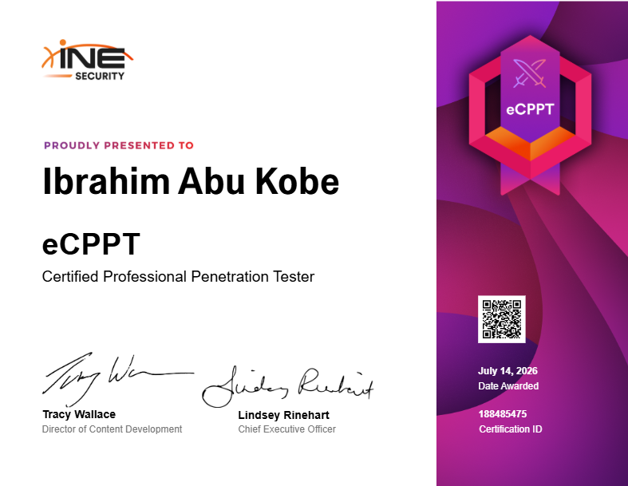

# 🛡️ eLearn Certified Professional Penetration Tester (eCPPTv3)

  

Welcome to my official repository documenting my methodologies, toolset, and practical notes for the **eLearnSecurity Certified Professional Penetration Tester (eCPPTv3)** certification.

This repository serves as a structured knowledge base for professional-level penetration testing, encompassing network and web application exploitation, Windows & Linux privilege escalation, lateral movement, and full Active Directory attack chains.

> 🏆 **Certified:** I successfully passed the eCPPTv3 exam on **14/07/2026**.

> ⏱️ **Exam Overview:** The eCPPT certification is a 100% practical, hands-on penetration testing exam. Unlike the eJPT, it is designed for professionals with 2+ years of offensive security experience and culminates in compromising a full corporate-style network, including Active Directory, with a written professional report as part of the assessment.

---

## 🎯 Core Competencies & Exam Domains

> Domain weightings below are sourced directly from INE's official eCPPT certification page.

### 🏢 Active Directory Penetration Testing (30%)
The single largest domain — reflects the exam's heavy focus on full AD compromise.
*   **AD Enumeration:** 🔍 Mapping domain users, groups, computers, and trust relationships (BloodHound, SharpHound, PowerView).
*   **Weak/Empty Passwords:** 🔑 Identifying domain accounts with weak or blank credentials.
*   **AS-REP Roasting:** 🎫 Stealing Kerberos tickets to crack offline for authentication.
*   **AD Lateral Movement:** 🔀 Pass-the-Hash (PtH) and Pass-the-Ticket (PtT) techniques across the domain.
*   **Domain Dominance:** 👑 Escalating from initial foothold to full Domain Admin privileges/access.

### 💥 Exploitation & Post-Exploitation (25%)
Focuses on turning identified weaknesses into system access and further compromise.
*   **Service Exploitation:** 🛠️ Identifying and exploiting vulnerabilities or misconfigurations in running services.
*   **Privilege Escalation:** ⚙️ Exploiting Windows and Linux privesc vectors (insecure service permissions, SUID binaries, sudo misconfigurations, token impersonation).
*   **Credential Attacks:** 🔐 Dumping and cracking password hashes (Hashcat, John the Ripper, Mimikatz/kiwi).
*   **Credential Hunting:** 🗝️ Locating locally stored, unsecured credentials on compromised hosts.

### 🚪 Initial Access (15%)
Covers the techniques used to gain the first foothold on a target environment.
*   **Username Enumeration:** 👤 Identifying valid user accounts on target systems (Kerbrute, SMB null sessions).
*   **Password Spraying:** 💦 Testing common/weak passwords against many accounts to avoid lockouts.
*   **Brute-Force Attacks:** 🔓 Attacking remote access services (SSH, RDP, SMB) for initial access.

### 🌐 Web Application Penetration Testing (15%)
Covers exploitation of web-facing targets as an entry point into the environment.
*   **Web Enumeration:** 🕷️ Identifying vulnerabilities and misconfigurations in web applications.
*   **Common Vuln Exploitation:** 💉 Exploiting SQL Injection, XSS, Command Injection, and similar flaws for initial access.
*   **Login Brute-Forcing:** 🔑 Attacking web authentication forms.
*   **Component Exploitation:** 📦 Exploiting outdated or vulnerable web application components/plugins.
*   **Data Exfiltration:** 📤 Extracting data and credentials from compromised web apps and databases.

### 🔍 Information Gathering & Reconnaissance (10%)
The foundational discovery phase before any active exploitation.
*   **Host & Port Discovery:** 📡 Locating live hosts and scanning for open ports across target networks.
*   **Service Enumeration:** 🚪 Enumerating information from services running on discovered ports.

### 🧨 Exploit Development (5%)
The smallest domain, but a key differentiator from the eJPT.
*   **Exploit Modification:** 🛠️ Developing or modifying exploit code for initial access and post-exploitation.
*   **Memory Corruption:** 💣 Identifying and exploiting stack/buffer overflow vulnerabilities.

---

## 🧭 Topics Covered in These Notes

- **PowerShell for Pentesters** — fundamentals, cmdlets, modules, scripting for offensive tasks
- **Network Penetration Testing** — DNS recon, Nmap scanning/evasion, service enumeration, SNMP, MSSQL exploitation
- **Privilege Escalation** — Windows (PowerUp, PrivescCheck, token impersonation, Juicy Potato) & Linux (SUID, sudo misconfig)
- **Active Directory Penetration Testing** — password spraying, BloodHound/PowerView, Kerberoasting, AS-REP Roasting, PtH/PtT, DCSync, trust attacks
- **Lateral Movement & Pivoting** — PsExec, SMBExec, CrackMapExec, WinRM, RDP, SOCKS proxying, SSH tunneling
- **Web Application Penetration Testing** — fingerprinting, XSS (reflected/stored/DOM), SQLi (ZAP, SQLMap), Amass

---

## 📖 Contents

| # | Topic | File |
|---|-------|------|
| 1 | PowerShell for Pentesters | [1. PowerShell For Pentesters](1__Powershell_For_Pentesters.md) |
| 2 | Network Penetration Testing | [Network Penetration Testing](Network_Penetration_Testing.md) |
| 3 | Privilege Escalation | [1. Privilege Escalation](1__Privilege_Escalation.md) |
| 4 | Active Directory Penetration Testing | [Active Directory Penetration Testing](Active_Directory_Penetration_Testing.md) |
| 5 | Lateral Movement & Pivoting | [2. Lateral Movement & Pivoting](2__Lateral_Movement___Pivoting.md) |
| 6 | Web Application Penetration Testing | [Web Application Penetration Testing](Web_Application_Penetration_testing.md) |

---

## 📚 Related Certifications

- [eJPT Repository](#) — Junior-level foundations (reconnaissance, basic exploitation, Metasploit basics)
- eCPPT builds directly on eJPT, adding Active Directory, exploit development, and advanced post-exploitation

---

## ⭐ Feedback / Contributing

These are personal study notes, but if you spot an error, outdated command, or want to suggest an addition, feel free to open an issue or submit a pull request.

---

🧑‍💻 *eCPPTv3 Certified — 14/07/2026*
